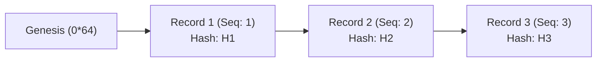

# Phase 15: Walk-Forward Model Evaluation, Paper Monitor & Audit Integrity

## 1. 概要 (Overview)
本仕様書は、Phase 14 の確率校正・ペーパー運用監査基盤を土台として、**複数期間にわたるローリング・ウォークフォワード（Walk-Forward）時系列検証**、**ペーパー運用モニタリング**、および**暗号学的ハッシュチェーンによる監査ログ改ざん検知**を設計・実装したものである。

> [!WARNING]
> **ゼロコストおよび合成ベンチマーク免責事項**:
> - 本フェーズは追加費用0円の完全ローカル環境で動作し、有料API契約・スクレイピング・外部課金は一切行わない。
> - 生成・出力される評価メトリクスおよび意思決定ログは合成ベンチマークフィクスチャによるものであり、**実運用における市場成績や実際の馬券払戻を意味するものではない**。
> - 未検証のオッズや架空の払戻に基づく ROI の主張は行わず、公式データが揃わない場合はすべて「評価不可」と表示する。
> - **ローカルハッシュ連鎖の限界**: SHA-256 ハッシュチェーンはローカルログの事後改ざん（削除・順序入替・内容改変）を検知するものであり、外部から入力されたオッズや着順データの真正性そのものを証明するものではない。

---

## 2. ウォークフォワード時系列検証 (Walk-Forward Architecture)

時系列データにおける将来情報のリークを厳格に遮断しつつ、モデルの経時的な汎化性能と校正安定性を評価するため、順送り（Expanding / Rolling Window）による複数 Fold の時系列分割を実施する。

### 2.1 分割構造 (Per-Fold Partitioning)
各 Fold $k$ において、以下の3期間を時系列順に厳密分離する。

$$\text{Train}_k \quad \longrightarrow \quad \text{Calibration}_k \quad \longrightarrow \quad \text{Test}_k$$

- **不変条件 (Invariants)**:
  1. $\max(\text{Train}_k \text{ Start}) < \min(\text{Calibration}_k \text{ Start}) \le \max(\text{Calibration}_k \text{ Start}) < \min(\text{Test}_k \text{ Start})$
  2. 同一の `race_id` が異なる期間に跨がってはならない（Purging）。
  3. 各行の特徴量観測時刻は、発走時刻および締切時刻よりも過去でなければならない（`feature_observed_at < cutoff_at < race_start_at`）。
  4. 事前オッズ観測時刻は、予測時刻および発走時刻より過去でなければならない（`odds_observed_at <= prediction_at < cutoff_at < race_start_at`）。

### 2.2 Fold 別評価指標 & 集計
- Fold ごとに以下を独立測定：
  - サンプル数（Train / Calibration / Test レース数・出走頭数）
  - Log Loss（校正前 vs 校正後）
  - Brier Score（校正前 vs 校正後）
  - Expected Calibration Error (ECE: 10ビン分割)
  - Top-1 的中率 (Precision@1)
  - ペーパー意思決定（BET件数、SKIP件数）
- Fold 間の平均値（Mean）を算出し、母数（有効 Fold 数）を明示。
- サンプル不足（必要最小レース数未満）の場合は即座に `status: "unevaluable_insufficient_samples"` として評価不能扱い。

---

## 3. 改ざん検知ハッシュチェーン (Tamper-Evident Hash Chain)

ペーパー運用の意思決定ログの再現性と証跡の不変性を担保するため、各監査レコードを SHA-256 ハッシュで直前のレコードと暗号学的に連鎖させる。



### 3.1 レコード構造
- `sequence_id`: 1から始まる一意な連番。
- `previous_hash`: 直前レコードの `record_hash`（先頭レコードは `0*64` の Genesis ハッシュ）。
- `record_hash`: 本レコードの正規化 JSON（キーソート済み）の SHA-256 チェックサム。

### 3.2 改ざん検知ルール
- 連番の欠損・順序入替 $\rightarrow$ `ValueError: Sequence break`
- 直前ハッシュの不一致 $\rightarrow$ `ValueError: Hash chain break`
- レコード内フィールド（オッズ、予測確率、意思決定）の1文字・1バイトの改変 $\rightarrow$ `ValueError: Tamper detected`

---

## 4. 実行CLIと入出力仕様

### 4.1 CLI コマンド
```bash
python scripts/phase15_walkforward_paper_monitor.py \
  --seed 42 \
  --folds 3 \
  --races 40 \
  --output-report reports/phase15_summary.json \
  --output-audit-log logs/phase15_decisions.jsonl
```

### 4.2 出力フォーマット
- **Summary Report (JSON)**: 各 Fold の指標、全 Fold 平均、ハッシュチェーン検証結果、免責事項。
- **Decision Audit Log (JSONL)**: 各出走馬ごとの意思決定（BET / SKIP）、判断理由、ハッシュチェーン連鎖メタデータ。
